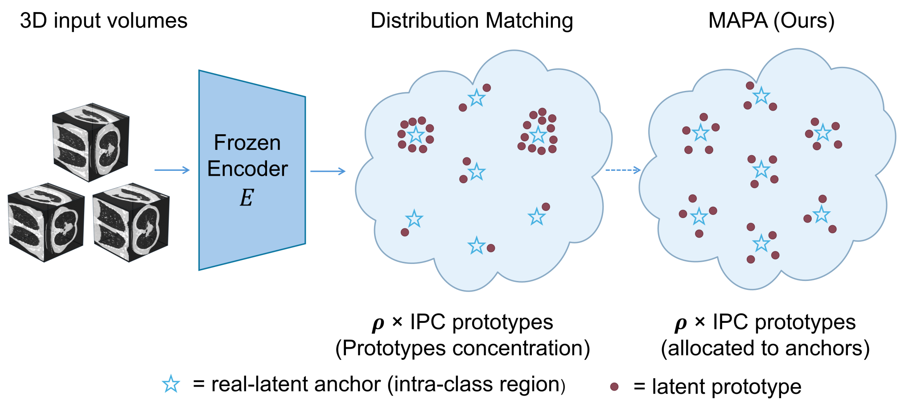
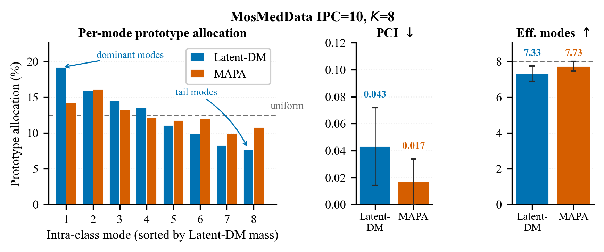

<h1 align="center">MAPA</h1>
<h3 align="center">Mode-Aware Prototype Allocation for Latent Dataset Distillation<br>in 3D Medical Classification</h3>

<p align="center">
  <b>WACV 2027</b><br>
  Weiqi Zhang &nbsp;&nbsp; Hiroyuki Kubo<br>
  Chiba University
</p>

<p align="center">
  <a href="#paper">Paper · coming soon</a> &nbsp;|&nbsp;
  <a href="#quick-demo">Quick demo</a> &nbsp;|&nbsp;
  <a href="docs/demo.md">Demo guide</a>
</p>

<p align="center"></p>

MAPA allocates a compact set of latent prototypes across intra-class modes for 3D medical classification. Fixed anchors estimate these modes from real training latents, while class-level matching is preserved.

## Method

<p align="center"></p>

Volumes are encoded into a frozen latent space. MAPA optimizes prototypes through class-level matching and soft allocation, then decodes them for downstream training.

## Prototype allocation

<p align="center"></p>

*MosMedData, IPC 10. MAPA spreads the prototype budget more evenly across the fixed anchors. PCI is a concentration diagnostic.*

## Quick demo

```bash
git clone https://github.com/WeiqiZhang1999/MAPA.git
cd MAPA
python -m pip install -r requirements.txt
python demo/examples/run_organmnist3d.py --simulate --device cpu
```

The CPU demo uses simulated volumes with the OrganMNIST3D data schema. It checks the pipeline and does not reproduce the paper's benchmark results. See the [demo guide](docs/demo.md) for optional 3D baselines and output files.

## Paper

**Paper link coming soon.** The arXiv preprint or official conference proceedings link will be added here.

<!-- PAPER_URL: replace the placeholder above and the header Paper link when an arXiv or CVF URL is available. -->
<!-- CITATION: add the final BibTeX entry when the paper link is available. -->
